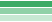
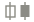
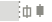
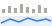

# TQQQ Support Level Report

[](https://mpromisel002.github.io/TQQQ-Technical-Analysis-Report/)

A daily-updated web dashboard that finds and visualises **support levels** in TQQQ — the price areas where the fund has repeatedly stopped falling and turned back up. It also covers QQQ and SPY, and can show any other stock or fund on request. It runs on GitHub Pages, refreshes itself every weekday evening after the US market close, and needs no server, database or paid data feed.

**Live site:** https://mpromisel002.github.io/TQQQ-Technical-Analysis-Report/

The look-back window is configurable from **1 month up to 12 months** (or any custom number of trading sessions between 21 and 252), and the whole report recalculates instantly in the browser when you change it.

> **Educational use only — not investment advice.** See [Disclaimer](#disclaimer).

---

## Contents

- [Start here: what the page tells you](#start-here-what-the-page-tells-you)
- [Plain-English glossary](#plain-english-glossary)
- [What's on the page, section by section](#whats-on-the-page-section-by-section)
- [What the key findings cover](#what-the-key-findings-cover)
- [How to read the main chart](#how-to-read-the-main-chart)
- [Settings you can change](#settings-you-can-change)
- [How support levels are calculated](#how-support-levels-are-calculated)
- [Methodology, provenance & comparable reports](#methodology-provenance--comparable-reports)
- [How the daily refresh works](#how-the-daily-refresh-works)
- [Repository layout](#repository-layout)
- [Setup](#setup)
- [Run it locally](#run-it-locally)
- [Limitations you should know about](#limitations-you-should-know-about)
- [Change log](#change-log)
- [Disclaimer](#disclaimer)

---

## Start here: what the page tells you

TQQQ is an exchange-traded fund that aims to deliver **three times the daily move** of the Nasdaq-100. It moves fast — roughly 3–4% on an average day — so the question "where has buying reliably shown up before?" is a useful one.

This report answers that question in four steps:

1. It finds every **swing low** in the chosen period — days where the price dipped and then turned back up.
2. It **groups** nearby swing lows into price *zones*, because real support is an area, not an exact number.
3. It **scores** each zone from 0 to 100 on how dependable it has been.
4. It lists every zone found over at least the last 200 sessions, labels those below the price **S1** (closest to today's price), **S2** and so on, and writes out what it found in plain sentences. Zones the price has since fallen below are drawn too, in grey, as **levels above the price** (**A1**, **A2**, …).

Everything else on the page — the trend call, RSI, MACD, the comparison with a benchmark (QQQ for TQQQ) — is context to help you judge whether those levels are likely to matter right now.

---

## Plain-English glossary

No prior charting knowledge needed. These are the only terms the report uses.

| Term | What it means |
|---|---|
| **TQQQ** | ProShares UltraPro QQQ, a fund that targets 3× the *daily* return of the Nasdaq-100 index. It resets that 3× target every day, which is why its return over a month is rarely exactly 3× the index's monthly return. |
| **QQQ** | The plain, unleveraged Nasdaq-100 fund. Used here as the benchmark to compare against. |
| **Support** | A price area where buyers have repeatedly stepped in and stopped a fall. It describes what has happened before — it is not a promise about the future. |
| **Swing low** | A single day that is lower than the 3 days before it *and* the 3 days after it. A local bottom. The "3" is the **swing period**, and it is adjustable. |
| **Pending swing low** | A recent dip that looks like a swing low but can't be confirmed yet, because the 3 days that have to follow it haven't happened. Drawn as a hollow marker. |
| **Zone** | Several swing lows at nearly the same price, merged into one band. Shown as a shaded green stripe on the chart. |
| **Touch** | One swing low inside a zone. A zone touched 5 times has been defended by buyers 5 separate times. |
| **Window** | How far back the method looks. A 12-month window surfaces long-standing levels; a 1-month window surfaces only what is relevant right now. |
| **Level above price** | A zone the price has since closed clearly below, labelled **A1** (nearest) upwards. It no longer counts as support, but it stays on the chart and in the table because rises often stall where an old floor gave way. The break is also reported under "What changed". |
| **Strength** | A 0–100 score combining how often, how recently, on what volume and with what follow-through a zone has held. Labelled **Strong** (70+), **Moderate** (40–69) or **Weak** (under 40). |
| **Moving average (MA)** | The average closing price over the last 20, 50 or 200 days. A smoothed line that shows the direction of the trend without the daily noise. |
| **Golden cross / death cross** | The 50-day average crossing above (golden) or below (death) the 200-day average. A widely watched, slow-moving trend signal. |
| **ATR** (Average True Range) | The size of a typical day's move, in dollars. TQQQ's ATR is used here to decide how wide a support zone should be, and how far below a level a protective stop would sit. |
| **RSI** (Relative Strength Index) | A 0–100 momentum gauge. Above 70 the recent rise looks stretched; below 30 the recent fall looks stretched. Neither is a buy or sell signal on its own. |
| **MACD** | Compares a fast and a slow moving average to show whether momentum is building (bullish) or fading (bearish). |
| **Bollinger Bands** | A band drawn two standard deviations above and below the 20-day average — a sense of what "normal range" currently means. |
| **Drawdown** | How far below its 12-month high the price currently sits, as a percentage. |
| **Beta** | How much TQQQ moves for each 1% move in QQQ. It should sit near 3.0; a reading far from 3 is worth a second look at the data. |
| **Trading session** | One day the US market is open. There are about 21 in a month and 252 in a year — which is why the window presets are 21, 63, 126, 189 and 252 sessions. |

---

## What's on the page, section by section

| Section | What it shows | Why it's there |
|---|---|---|
| **Key numbers** | Last close, trend, nearest support, strongest support, RSI, distance below the 12-month high. Before the open and after the close, the latest pre-market or after-hours price sits under the last close | The six numbers most decisions start from |
| **Bottom line** | A one-sentence headline, then labelled lines: nearest floor, if that breaks, the level above the price, trend, buyers vs sellers, risk, and **since the previous session** (what changed) | The answer before the evidence, written so it needs no glossary — it says what the indicators *mean* rather than naming them. A reader who stops here still leaves with the number that matters |
| **All findings** (collapsed) | 10+ plain-language findings in four groups — support levels, trend, momentum & volatility, risk & leverage | The full picture for anyone who wants it, one click away; see [What the key findings cover](#what-the-key-findings-cover) |
| **Price & support zones** | Candlestick chart with shaded green support bands, swing-low markers, moving averages, and optional volume / RSI / MACD / drawdown panels | The main visualisation — see [How to read the main chart](#how-to-read-the-main-chart) |
| **Support levels in detail** | A table of every level found — above the price (A1…) and below it (S1…), in price order: zone price, zone range, distance from price, times held, last tested, strength and status | The numbers behind the chart, with a definition list underneath every column |
| **Does the level hold up at other window lengths?** | The same method run over 1, 3, 6 and 12 months, one column each | Guards against cherry-picking. A level that appears in only one window may be an artefact of that window; a level that appears in three or more is far more dependable |
| **TQQQ vs QQQ** (each ticker against its benchmark) | Growth of $100 over the window, plus return, beta and volatility | Shows the cost of daily 3× resetting — TQQQ's return over a period is usually *not* 3× QQQ's return over that period |
| **Technical indicators** | Moving averages, RSI, MACD, Bollinger Bands, ATR and volume, each with a reading and a plain-language explanation | Context: is the broader trend helping or fighting these levels? |
| **Method, definitions & data** | Glossary, the full method, and the data provenance | Everything needed to audit or reproduce the numbers |

Two download buttons sit in the toolbar: **Download CSV** (the levels table plus every daily row in the window, with indicators) and **Download PNG** (the chart as an image, captioned with the window and data date).

---

## What the key findings cover

The card leads with a **bottom line** — one headline sentence and labelled lines (nearest floor, if that breaks, the level above the price, trend, buyers vs sellers, risk, since the previous session), deliberately written without naming a single indicator, so it needs no glossary — and keeps the full findings list collapsed behind a toggle, so the summary is never buried under the evidence. The toggle state is remembered per browser.

The findings are generated from the data on every load — nothing is written by hand — and they re-run whenever you change the window or the method settings. A normal window produces **14 findings** in four groups, and 15 when there is a level above the price (a finding naming the nearest one); a window too short to contain much structure still produces at least ten, with the support findings saying so plainly rather than going quiet.

| Group | Findings |
|---|---|
| **Support levels** | 1. `S1`, the first floor under price: its band, distance, number of touches, date last tested and strength score.<br>2. The next level down and the gap to it, expressed both in percent and in *typical days of movement*, so the drop has a time dimension.<br>3. The most dependable level in the window, with its touch count, volume versus the window average and score.<br>4. Cross-window confirmation — which levels survive at least three of the 1, 3, 6 and 12-month look-backs.<br>5. The rolling low as the immediate floor, plus a count of any zones that have broken. |
| **Trend** | 6. The trend call and which of the three checks agree or conflict.<br>7. Price versus the 50- and 200-day averages, the 50-day slope over 20 sessions, and the date of the last golden or death cross.<br>8. Distance below the 12-month high, position within the 12-month range, the number of confirmed swing lows, and whether the last two are rising. |
| **Momentum & volatility** | 9. RSI, read as *confirmation* for the levels rather than a signal of its own.<br>10. MACD direction and the width of the gap to its signal line.<br>11. Bollinger position, today's ATR against the window's median ATR (a calm-or-choppy read), and volume against its 20-day average. |
| **Risk & leverage** | 12. Typical daily move, and where a stop one full day's range below `S1` would sit.<br>13. TQQQ against QQQ over the window: actual return, the naive 3× return, **the compounding lost to daily resetting**, beta and annualised volatility.<br>14. What the levels are not — plus how many recent dips are still unconfirmed, and therefore able to change the picture. |

Two design choices worth naming. Findings are **grouped rather than ranked**, because a reader looking for risk should not have to scan momentum to find it. And the wording follows the numbers: the same finding says "calmer than usual", "about normal" or "choppier than usual" depending on where the current reading sits against its own window, instead of asserting a fixed threshold.

---

## How to read the main chart

| | What you see | What it means |
|:--:|---|---|
|  | **Shaded green band** | A support zone. It spans the whole chart because a support level is a price, not a moment in time. |
|  | **Darker green = stronger** | Opacity is stepped by the strength tier, so Strong zones are visibly darker than Weak ones. |
|  | **Green tag, right edge** | The zone's ID and its centre price. **S1** is nearest today's price, **S5** is furthest below. |
| | **Light blue band with dashed edges** | Bollinger Bands, when switched on: the normal range around the 20-day average, two standard deviations either side. A close outside it is unusual. On by default; turn off with the **Bollinger Bands** switch, and that choice is remembered. |
| | **Grey band, dashed line, A-tag** | A level above the price: an old support zone the price has since closed below. The nearest one (A1) is always shown; the **More levels above** switch shows or hides the rest. |
|  | **Dark tag, right edge** | The last closing price. |
|  | **Solid green triangle** | A swing low that helped build one of the support levels below the price. |
|  | **Faded green triangle** | A swing low that is not part of a support level below the price (for example, one in a level the price has since fallen through). |
|  | **Hollow green triangle** | A pending swing low — too recent to confirm, because the three sessions that have to follow it haven't happened. |
|  | **Hollow / filled candle** | An up day / a down day. Shape as well as colour, so direction still reads for colour-blind viewers. |
|  | **Pink staircase** | The rolling 3-day low — the lowest low of the last three sessions, and the nearest very-short-term floor. |
|  | **Blue / orange / purple lines** | The 20-, 50- and 200-day moving averages. |
|  | **Greyed-out area on the left** | History older than the level search (at least 200 sessions). Shown for context; not used to find levels. |
| | **"▼ S3 $50.18 · 3 more below" tag** | Levels outside the part of the chart in view; the nearest one is named. The chart always reaches down to the next floor below the current one (S2), unless that would stretch the price scale by more than half — then that floor is the one named here. |
|  | **Panels below the price** | Volume, RSI, MACD and drawdown, all sharing the same date axis. |
|  | **One bar = one day, or one Monday** | The Daily / Mondays toggle in the toolbar above the chart. Mondays draws each Monday's session only and skips the other four days. |

**Interaction:** the chart follows the same rules as most chart sites. Scrolling up or down over it scrolls the page. **To zoom**, pinch on a trackpad or touchscreen, hold Ctrl (⌘ on a Mac) and scroll, or use the **+** and **−** buttons. **To move through time**, swipe sideways with two fingers, hold Shift and scroll, or drag. Double-click, the **0** key or **Reset view** go back to the window you picked. Hover or tap a bar for its numbers.

**Daily / Mondays.** The toggle in the toolbar above the chart switches between one bar per trading session and one bar per week — each week's Monday, and nothing else. Mondays is far easier to read across a long stretch: about 105 bars instead of 500 over two years. Because it is a *sample* rather than a summary, the other four days are simply not drawn — a level tested hard on a Wednesday will not appear in this view, though it still counts in the levels table, which always uses every session. When a Monday was a market holiday the chart falls back to that week's first trading day so no week goes missing. It is a display choice only: levels, scores and statuses are always computed on daily data. Your choice is remembered in your browser.

Only Volume and RSI are on by default — the chart is deliberately quiet until you ask for more.

---

## Settings you can change

### The window (the headline setting)

In the toolbar directly above the chart: buttons for **1M, 3M, 6M, 9M, 12M**, plus a free-text box for any value from **21 to 252 trading sessions**. A shorter window reacts faster and finds fewer, more recent levels; a longer window finds levels that have survived more market conditions. The page opens on **1M** the first time; after that it reopens with the window and settings you last used in that browser (a link that includes settings wins). "What changed" always compares the levels the page opens on (the last 200 sessions, 3-day swings), whatever window you pick, so each day is compared on the same basis.

### Method settings (under the "Method settings" dropdown)

| Setting | Range | Default | What it does |
|---|---|---|---|
| **Swing period** | 2–10 sessions | 3 | How many days either side of a dip must be higher for it to count as a swing low. Higher = fewer, more significant lows. |
| **Cluster distance** | 0.25–1.5 × ATR | 0.5 | How close two swing lows must be to be merged into one zone. Higher = fewer, wider zones. |
| **Minimum touches** | 1–5 | 1 | Drop zones that have been tested fewer than this many times. Set to 2 to see only levels that have held more than once. |

### Shareable links

Every setting is written into the page address, so any view can be bookmarked or sent to someone else:

```
?window=6m                 six-month window
?window=100                custom 100-session window
?window=6m&period=5        six months, 5-day swings
?window=12m&cluster=0.75&touches=2   wider zones, only levels held twice or more
?show=zones,sma50,sma200   only these chart layers (Simple view); ?show=none hides them all
```

`show` is added only when the chart layers differ from the defaults, and a link that carries it wins over the layers a reader has saved.

### Chart layers

Every layer of the main chart has a switch, in two rows. **On the price chart:** more support below the price, more levels above it, the 20, 50 and 200-day averages, Bollinger Bands, swing lows, the 3-day low and volume by price. **Panels below:** volume, RSI, MACD and % below the 12-month high. The nearest level below or at the price (S1 — the zone the price is in, when it is in one) and the nearest above (A1) are always on the chart; the two level switches add the rest. **Simple view** shows only the candles, the support below the price and the 50 and 200-day averages; **Show all** turns everything on. The legend lists only what is shown, and the choice is remembered in the browser.

---

## How support levels are calculated

The whole method lives in one file, [`docs/js/support.js`](docs/js/support.js). The same file runs in the browser, in Node for the nightly snapshot job, and in the unit tests — so there is exactly one implementation to audit.

**1. Find the swing lows.**
A day is a swing low when its low is the lowest from *N* sessions before it to *N* sessions after it (*N* = the swing period, 3 by default). The most recent *N* sessions can't be confirmed yet — a lower low could still arrive — so they are marked *pending* and drawn hollow.

**2. Compute the rolling low.**
Separately, the lowest low of the last *N* sessions is tracked at every bar and drawn as a step line. This is the literal "3-day rolling period" floor, and it doubles as a fallback level when a window is too short to contain any confirmed swing low.

**3. Cluster nearby lows into zones.**
Swing lows within `clusterDistance × ATR(14)` of each other are merged. At the default 0.5 × ATR that is roughly 2–3% of TQQQ's price. Each zone gets:
- a **zone price** — the volume-weighted average of its lows, so the days with the heaviest trading pull the number towards them;
- a **zone range** — from the lowest to the highest low in the group.

**4. Score each zone from 0 to 100.**

| Component | Weight | How it's measured |
|---|---|---|
| Touches | 40% | Number of swing lows in the zone, relative to the busiest zone in the window |
| Recency | 30% | How recently the zone was last tested, as a fraction of the window |
| Volume | 20% | Average volume on the touch days, versus the window's average volume |
| Bounce | 10% | How far price travelled away from the zone within the following 10 sessions |

Scores are normalised **within the selected window**, so they rank levels against each other — a score of 80 in a 1-month window is not directly comparable to an 80 in a 12-month window.

**5. List every level.**
On the page, every zone found is listed, nearest the price first: below it S1, S2, …, above it A1, A2, …. Levels are found over **at least the last 200 sessions**, or the window if it is longer (12 months uses 252). The window you pick still sets how much of the chart opens and the period for returns and volatility. The daily snapshot and "What changed" keep a fixed setting — the levels the page opens on (the last 200 sessions, 3-day swings, every level) — so each day is compared on the same basis.

**6. Drop broken zones.**
Once price closes more than half the cluster distance below a zone, that zone is no longer support. It moves to the levels above the price (A1, A2, …), drawn in grey and listed above the last close in the table, and the break is reported in "What changed since the previous session". A zone that was broken earlier in the window but has since been reclaimed is flagged *broke once before* in the table — it has a track record of failing.

**7. When a window is too thin.**
If fewer than two confirmed zones are found (common with a 1-month window in a strong rally), the report falls back to the rolling low and the 50-day average, clearly labelled as fallbacks, and suggests a longer window.

### The trend call

Three independent checks, all of which must agree:

1. Is price above **both** the 50- and 200-day averages, or below both?
2. Is the 50-day average rising or falling over the last 20 sessions?
3. Are the last two swing lows rising or falling?

All three bullish → **Uptrend**. All three bearish → **Downtrend**. Anything else → **Mixed**, which is an honest answer rather than a forced call.

---

## Methodology, provenance & comparable reports

### Where each technique comes from

Nothing in this report is a private indicator. Every component is a documented, decades-old technique, which is deliberate: a level you cannot explain is a level you cannot defend to whoever asks about it.

| Component | Origin |
|---|---|
| **RSI** and **ATR** | J. Welles Wilder Jr., *New Concepts in Technical Trading Systems* (1978), which introduced both along with Wilder's smoothing method. ATR is used here for zone width and stop distance — closer to Wilder's original intent than the momentum reading RSI is usually reduced to. |
| **MACD** | Gerald Appel, developed in the late 1970s. Standard 12/26/9 parameters. |
| **Bollinger Bands** | John Bollinger, early 1980s. Used here only to say where price sits in its normal 20-day range, not as a signal. |
| **Swing highs and lows** | The generic pivot rule — a bar that is the extreme of the *k* bars either side. Bill Williams' "fractals" (*Trading Chaos*, 1995) are the best-known named version, using k = 2. This report defaults to k = 3, matching the brief, and exposes k as a setting. |
| **Higher lows as trend evidence** | Dow Theory's core observation that an advancing market makes successively higher lows. It is one of the three checks behind the trend call. |
| **Volume-weighted price levels** | The market-profile tradition associated with J. Peter Steidlmayer's work at the Chicago Board of Trade in the 1980s: price areas matter in proportion to the business transacted there. Zone prices here are volume-weighted for the same reason. |
| **Golden / death cross** | Long-standing 50/200-day moving-average convention with no single originator. Reported as a dated event, not a recommendation. |

### What this report decides for itself

Three things are **not** inherited from the literature, and should be treated as engineering judgment rather than established fact:

1. **The 0–100 strength score.** Weighting touches 40%, recency 30%, volume 20% and bounce 10% is a reasoned ranking heuristic, *not* a fitted or backtested model. It orders levels within one window; it is not a probability that a level will hold, and it should never be read as one.
2. **Clustering at 0.5 × ATR.** Merging swing lows within half an average day's range is a volatility-relative choice, so it adapts as TQQQ calms down or speeds up. The multiplier is adjustable precisely because it is a judgment call.
3. **The break rule.** A close more than half the cluster distance below a zone retires it. A tolerance is needed because a leveraged fund pierces levels intraday constantly; where exactly to set it is a choice.

### What the research actually supports

Worth stating plainly, because it affects how much weight the output deserves:

- Brock, Lakonishok and LeBaron, *Simple Technical Trading Rules and the Stochastic Properties of Stock Returns* (Journal of Finance, 1992), found statistically significant results for moving-average and trading-range-break rules on the Dow — while noting that transaction costs and data-snooping concerns temper the conclusion. Later work has argued much of the effect weakened after publication.
- Carol Osler's research at the Federal Reserve Bank of New York on published support and resistance levels in currency markets found that such levels did cluster with intraday reversals more often than chance — evidence that these levels function partly because enough participants watch them.

The honest summary: support levels are a defensible way to describe where transactions have clustered and where reversals have historically occurred. They are not a forecast, and this report is built to inform a decision rather than make one.

### Comparable reports

This dashboard sits in a well-populated genre. Useful reference points, if you want to compare format and rigour:

- **Broker technical-opinion pages** (Fidelity, Schwab and similar) — a single symbol, a trend verdict, a handful of indicator readings in plain language. Closest in audience to this report; generally shallower on method disclosure.
- **Charting-platform auto support/resistance indicators** (TradingView and StockCharts both host many) — the same pivot-detection-plus-clustering approach this report uses, usually drawn on the chart with no written explanation and no reproducibility.
- **Sell-side technical strategy notes** — a chart, marked levels, and a paragraph of narrative. Stronger on judgment, weaker on being re-runnable by the reader.
- **Quantitative factor tear sheets** (the style popularised by open-source portfolio-analytics libraries) — dense, reproducible, and aimed at practitioners. This report borrows their reproducibility while staying readable by a non-specialist.

Where this one differs: the method is a single auditable file, the window is a control rather than an assumption, every level carries its evidence (touches, dates, volume, score), and the whole report regenerates unattended each weekday.

---

## How the daily refresh works

```
GitHub Actions — every 30 min from 16:15 New York, first to find new data wins
  20:15 / 20:45 / 21:15 / 21:45 / 22:15 / 22:45 UTC  Mon-Fri
       = 16:15 - 18:45 New York in summer, 15:15 - 17:45 in winter
  11:30 UTC Tue-Sat  (7:30am New York, backstop before the next open)
  │
  ├─ pipeline/data_branch.sh get   check out the market-data branch; docs/data points at it
  │
  ├─ pipeline/build.py     download each ticker's and its benchmark's daily prices
  │                        (yfinance → Yahoo chart API → Tiingo → Alpha Vantage)
  │                        validate, compute indicators, write data/tqqq.json
  │
  ├─ pipeline/snapshot.js  save today's levels to data/history/YYYY-MM-DD.json
  │                        and write data/changes.json (the daily diff)
  │
  └─ pipeline/data_branch.sh put   commit to the market-data branch (not main)

GitHub Pages serves the page from main's /docs; the page reads its data from the
market-data branch through GitHub's raw-file address (raw.githubusercontent.com).
```

- Prices are **adjusted for splits and dividends**. About two years of history are loaded so the 200-day average is available across the full 12-month view.
- **Nothing publishes unless the data passes validation:** no missing values, no zero-volume days, highs never below lows, no gaps in the trading calendar, and no single-day move above 40% (which usually means a bad split adjustment). If a check fails, the previous good file stays live.
- If a run fails, the workflow **opens a GitHub issue** (or comments on the existing one). The page also shows the data date in red and displays a banner as soon as any session before today is missing, so a silent failure can't go unnoticed.
- **Sources are raced on freshness, not just tried in order.** A source that validates is accepted immediately only if it reaches the most recent close; otherwise the remaining sources are tried and the freshest result wins. One provider lagging a session no longer decides what gets published.
- **The newest bar's close is recovered when the provider lags.** For a while after the bell Yahoo leaves `close` null in its daily array while already reporting that day's close in the quote summary. The pipeline fills it from there — but only once the session is genuinely over and the rest of the bar is complete, so an in-progress price is never written as a close.
- **The job tries every 30 minutes from 16:15 New York.** That start is not arbitrary: `fetch.py` treats a session as complete from 16:15, so a run a minute earlier cannot publish the day's bar at all. GitHub queues scheduled runs on shared infrastructure and starts them 1–4 hours late in practice, so no single slot is dependable — whichever one first finds a new session publishes it, and the others exit in about 30 seconds without committing. A `concurrency` group serialises them, so two runs can never race to push.
- Cron is UTC and does not follow daylight saving, so the slots are anchored to EDT. Through the winter they run 15:15–17:45 New York, where the first two land before the close, find nothing and cost about 30 seconds each; 16:15 EST is covered by the third slot.
- **A provisional close corrects itself.** Publishing minutes after the bell means the newest bar may still be settling, so a later run republishes it if the source has since moved it — a corrected close, or a volume restatement. The commit is labelled *Data revision* rather than *Data refresh* so the two are distinguishable in the history.
  - The thresholds are deliberately not zero: 2 basis points on prices and 2% on volume. Below those it is sources rounding differently or consolidated volume trickling in, not a correction, and republishing on that noise would commit on every slot.
  - Revision only applies while the bar is still the newest completed session, which bounds it to roughly one trading day. After that the values are fixed; use `python pipeline/build.py --force` to rewrite an older session.
- If every source is still behind when a run publishes, `build.py` records a note like *"data ends 2026-09-17, 1 trading day(s) before the expected last close 2026-09-18"* in the file's metadata, which the page shows under **Method & data**.
- **The page states its own freshness.** `SR.freshness()` compares the published date against the most recent trading day whose 4pm close has passed (weekends and US market holidays skipped; the holiday rules match every trading day in two years of recorded prices) and resolves to one of three states:
  - **current** — nothing newer exists to publish, so no banner.
  - **pending** — only today's close is missing: the market has closed and the refresh has not published it yet. The date chip reads *"update pending"* and a quiet banner explains that the report rebuilds after the close. This is the normal state between about 4pm and 8pm New York, and it used to look indistinguishable from a broken pipeline.
  - **stale** — an earlier session is missing, so a run has failed. Red banner naming what is missing, and the date chip turns red. From Sep 21 to Oct 23, 2026 every session was published the same evening (at most 4.7 hours after the close), so this does not fire on a normal day.
- On weekends and market holidays the job finds no new session and exits cleanly without committing.
- **GitHub's cron is best-effort, not a guarantee.** Scheduled runs are queued on shared infrastructure and routinely start 1–2 hours late; under load they can be skipped entirely. That is the reason for the second daily run, and for the staleness banner on the page — neither the schedule nor any single run is treated as reliable on its own.
- **Scheduled workflows in a public repository are auto-disabled after 60 days of repository inactivity.** Do not assume the daily data commits reset that timer: pushes made by `github-actions[bot]` with the built-in `GITHUB_TOKEN` are widely reported not to count as the activity GitHub looks for. GitHub emails the repository admin before disabling, and re-enabling is one click in the Actions tab — treat that email as the real signal, and push a human commit occasionally if you want to be sure.
- The page is plain HTML, CSS and JavaScript with **no external dependencies** — the charts are drawn on a canvas by a small built-in library — so it loads fast and can't break because a CDN changed.

---

## Repository layout

The daily data is not on `main`: it is on the **`market-data` branch**, which holds only the `data/` folder and shares no history with `main`, so `main`'s history is code only. The nightly refresh and the add-ticker job commit there, and the page reads it from `https://raw.githubusercontent.com/<owner>/<repo>/market-data/` when it is served from GitHub Pages; anywhere else it reads its own `data/` folder. GitHub caches those addresses for 5 minutes. To download only the code, `git clone --single-branch`.

| Path | Purpose |
|---|---|
| `docs/index.html` | The page structure and all explanatory copy |
| `docs/css/style.css` | Styling, including the light/dark colour tokens |
| `docs/js/support.js` | **The method.** Swing lows, clustering, scoring, trend call, snapshots and diffs |
| `docs/js/charts.js` | Dependency-free canvas charts: stacked panes with pan/zoom, and the window-comparison dot chart |
| `docs/js/app.js` | Page controller: loads data, runs the method, renders every section |
| `docs/js/indicators.js` | The indicators in JavaScript, for a ticker shown live (the nightly job uses `pipeline/indicators.py`) |
| `data/tickers.json` (market-data branch) | The tickers the report covers, and the lookup service's address (`proxy`) |
| `pipeline/data_branch.sh` | Checks out the `market-data` branch and links it at `docs/data`; commits to it |
| `pipeline/add_ticker.py` | Adds a ticker to the list if it passes the nightly checks (run by `.github/workflows/add-ticker.yml`) |
| `proxy/` | The lookup service for any ticker (a Cloudflare Worker), and how to set it up |
| `data/tqqq.json` (market-data branch) | Latest prices and indicators, rewritten by each run |
| `data/history/` (market-data branch) | One dated snapshot of the levels per session (about 18 months kept) |
| `data/changes.json` (market-data branch) | The diff between the last two snapshots |
| `pipeline/fetch.py` | Downloads and validates prices, with three backup sources |
| `pipeline/indicators.py` | Moving averages, RSI, MACD, Bollinger Bands, ATR, drawdown |
| `pipeline/build.py` | Builds a ticker's data file, such as `data/tqqq.json` |
| `pipeline/snapshot.js` | Daily level snapshots and the "what changed" feed |
| `pipeline/tests/` | pytest checks on the saved price data |
| `tests/support.test.js` | Node unit tests for the support method |
| `tests/golden.test.js`, `tests/golden/` | The recorded support output, checked on every run |
| `tests/snapshot.test.js` | End-to-end test of the snapshot job |
| `tests/browser/`, `playwright.config.js` | Browser tests of the page (Playwright) |
| `tests/fixtures/` | Frozen data the JavaScript and browser tests run against |
| `.github/workflows/refresh.yml` | The daily schedule, manual trigger, tests, build, commit and failure issue |
| `.github/workflows/tests.yml` | Tests on every code push and pull request |
| `.github/workflows/security.yml` | Vulnerability checks on every pull request and every Monday |
| `.github/dependabot.yml` | Weekly pull requests for newer package and action versions |

---

## Setup

Forking this into your own repository takes about two minutes:

1. **Enable GitHub Pages** — Settings → Pages → *Deploy from a branch* → `main` / `/docs`.
2. **Let the workflow push** — Settings → Actions → General → Workflow permissions → *Read and write permissions*.
3. *(Optional)* **Add backup data sources** — Settings → Secrets and variables → Actions → add `TIINGO_API_KEY` and/or `ALPHAVANTAGE_API_KEY`. Both providers offer free keys. Without them the pipeline still works; it just has fewer fallbacks if Yahoo is down.
4. **Do a first run** — Actions → *Refresh TQQQ data* → Run workflow.

GitHub Pages is free for public repositories; private repositories need a paid plan.

### Tickers

The report covers every ticker on the list, `data/tickers.json` on the `market-data` branch — today TQQQ, QQQ and SPY. Pick one in the **Ticker** field at the top, or link to it with `?ticker=QQQ`; the choice is remembered. Each entry gives the name, the index it follows, its leverage, the benchmark it is compared with, and its folder:

```json
{ "symbol": "QQQ", "name": "Invesco QQQ Trust", "index": "Nasdaq-100", "leverage": 1, "benchmark": "SPY", "dir": "data/qqq" }
```

Each ticker's data is `<dir>/<symbol>.json` on the `market-data` branch, with its own `history/` and `changes.json`; TQQQ's files are directly in `data/`. The nightly refresh builds every ticker on the list; if one fails to download, the others are still published and the run is marked failed.

**To add a ticker by hand:** run `npm run data`, add its entry to `docs/data/tickers.json` (its benchmark must be on the list too), build its first data and history, and commit to the data branch:

```bash
python pipeline/build.py --symbol DIA
node pipeline/snapshot.js --symbol DIA --backfill 70
pipeline/data_branch.sh put "Add ticker: DIA"
```

All wording — the headline, findings, benchmark panel and disclaimer — comes from the entry. Leverage wording ("three times as much…", "daily resetting cost") appears only for leveraged funds.

### Any ticker

The **Ticker** field at the top suggests the tickers on the daily list; type any other stock or fund and press Enter. If it is not on the list, the page fetches two years of its prices through a small lookup service ([`proxy/`](proxy/README.md), a Cloudflare Worker), works out the indicators itself ([`docs/js/indicators.js`](docs/js/indicators.js), tested to match the Python on every day) and shows the full report live. History and "What changed" start once it is added.

**Add to the daily list** asks the lookup service to start the **Add a ticker** workflow. It adds the ticker only if it passes the same checks as the nightly refresh, builds its data and 70 sessions of history, and commits. Anyone can ask; the list stops at 50 tickers, and each visitor can ask for 5 a day. A ticker added this way gets plain (unleveraged) wording; its entry can be edited afterwards.

### Pre-market and after-hours price

From 4:00 to 9:30 and from 16:00 to 20:00 New York time, a line under **Last close** gives the latest pre-market or after-hours price, its change from the last regular close, and the time of that price — for example *"Pre-market $68.64 ▲ +0.31% from the Oct 26 close · 5:53 am New York time"*. The report is rebuilt a few hours after each close, so in the early evening the after-hours price is often measured from a newer close than the report shows; that close is then given with its price and marked as not yet in the report, and the card's label says which day's close it shows (*"Last close · Oct 23"*). It updates every minute, and asks nothing while the tab is in the background or outside those hours. It comes from Yahoo's one-minute prices through the lookup service, so it needs the service too. It is not a forecast of the open: it is the last price traded outside regular hours, often on light volume. Levels, scores and everything else on the page still use daily closes only.

The lookup service is not switched on until it is deployed and its address is put in `data/tickers.json` on the `market-data` branch as `"proxy"` — see [`proxy/README.md`](proxy/README.md). Until then the page says so, and everything else works as before.

---

## Run it locally

```bash
pip install -r pipeline/requirements.txt

npm run data                            # check out the market-data branch at docs/data
python pipeline/build.py --force        # download prices and build the data file
node pipeline/snapshot.js               # levels snapshot + "what changed"

python -m pytest -q pipeline/tests      # Python tests (data download and checks)
node --test tests/*.test.js             # JavaScript tests (the method and the snapshot job)
npm ci && npx playwright install chromium webkit
npx playwright test                     # browser tests (the page itself, in Chrome and Safari's engine)

python -m http.server -d docs 8000      # then open http://localhost:8000
pipeline/data_branch.sh put "message"   # only to publish data you built: commits to market-data
```

The tests need neither the data branch nor a network: they use frozen copies in `tests/fixtures/`.

Useful variations:

```bash
# Build offline from CSV files (columns: date,open,high,low,close,adjclose,volume)
python pipeline/build.py --csv-dir path/to/folder --force

# Rebuild the level history for the last 30 sessions
node pipeline/snapshot.js --backfill 30

# After a change that is meant to move support levels, re-record the expected output
UPDATE_GOLDEN=1 node --test tests/golden.test.js
```

### What the tests cover

All tests run on every pull request (`.github/workflows/tests.yml`), and the coverage for each file is shown on the run's summary page. The daily refresh runs the unit tests again before it publishes.

| Tests | What they check |
|---|---|
| `pipeline/tests/test_pipeline.py` | The checks on downloaded prices, the indicators, and when a corrected session is published again |
| `pipeline/tests/test_sources.py` | Which data source is used when one fails or lags, and how each source's reply is read. No network needed |
| `tests/support.test.js` | The support method: swing lows, zones, scores, statuses, findings, the bottom line, the Mondays view, freshness |
| `tests/golden.test.js` | Runs the method over every session in the frozen data, at 1, 3, 6 and 12 months, and compares every support level and "what changed" item with `tests/golden/levels.txt`. Any change that moves a level fails here and names the line. A second test checks, over the last 200 sessions at every window, that every level found is either listed (S below the price, A above it) or counted in the table's "not listed" line — none dropped, none listed twice, and none left out while a weaker one is shown |
| `tests/snapshot.test.js` | Runs the nightly snapshot job on a temporary folder: the files it writes, backfilling, and keeping at most 400 snapshots |
| `.github/workflows/security.yml` | Looks up every Python and npm package in the public vulnerability databases, on every pull request and every Monday, and checks the audit still catches a known vulnerable version |
| `tests/browser/rendering.spec.js` | Draws the main chart at every time frame (1–12 months and custom lengths), Daily and Mondays, light and dark, with the 13 chart switches in 28 settings (all off, all on, each alone, each off alone), the method settings at their limits, and clicking each switch — on desktop and phone, in Chrome and in Safari's engine. Each drawing is checked: no tag over another tag or a candle, the last-price tag exactly on its price, any moved tag joined to its level, every level tagged or counted in an edge tag, no date labels colliding or cut off, no candle cut off, panels and legend matching the switches. A self-check proves the checker catches a hidden candle |
| `.github/workflows/rendering-matrix.yml` | Every Monday and on demand: the same checks for every combination of the 7 switches that change where things are drawn (the four panels, Bollinger Bands and the two kinds of level), each with the other 6 all on and all off — 256 settings, 10,240 drawings |
| `tests/indicators.test.js`, `pipeline/tests/test_indicator_reference.py` | The JavaScript indicators match Python's on every day and every series, for TQQQ, QQQ and SPY, on the same prices |
| `tests/worker.test.js` | The lookup service with a fake Yahoo and GitHub: every reason a symbol is turned away, the 16:15 rule, starting the add job, and the 50-ticker and 5-a-day limits. The pre-market price from Yahoo's real reply, saved on 2026-10-27; after hours, regular hours and closed; when to ask again |
| `tests/browser/freshness.spec.js` | What the page says about its data at different times: current, update pending (only today's close missing), and out of date (an earlier close missing) |
| `tests/browser/extended-hours.spec.js` | The pre-market or after-hours line: its wording, up or down, updating, no line and no error when there is no price or no service, nothing from the service shown as HTML, and fitting a phone screen |
| `pipeline/tests/test_add_ticker.py` | Adding a ticker: checks first, data second, the list last — and the list unchanged if anything fails |
| `tests/browser/any-ticker.spec.js` | A ticker not on the list shown live, the add button's answers, a ticker turned away, and the lookup box |
| `tests/browser/tickers.spec.js` | The ticker menu, `?ticker=` links and remembering the choice, ticker-specific wording (no "TQQQ" or "3×" on QQQ's page), and a ticker not on the list |
| `pipeline/tests/test_tickers.py` | The ticker list is valid and every ticker has its data file; a broken list is stopped with the reason; building another ticker; older data files still work |
| `tests/browser/show-hide.spec.js` | Each switch hides its layer and legend entry; Simple view and Show all; the page address carries the layers and a shared link wins |
| `tests/browser/security.spec.js` | Puts HTML and script into every text field of the data files and checks none of it reaches the page as HTML |
| `tests/browser/data-branch.spec.js` | On GitHub Pages the page reads the list and every ticker's data from the `market-data` branch, and nothing from the site's own folder |
| `tests/browser/` | Opens the real page in Chrome and in Safari's engine, on a desktop and a phone screen size: every section appears, every control works, the chart responds to keyboard, mouse and trackpad (page scroll, sideways swipe, zoom), levels above price appear and can be hidden, the downloads work, and nothing makes the page scroll sideways |

The tests use a frozen copy of the data (`tests/fixtures/`, as of 2026-10-23) rather than the live file, which changes every weekday.

---

## Limitations you should know about

Worth reading before anyone acts on the output.

- **Support describes the past.** These levels are a summary of where buyers have shown up before. Markets are not obliged to repeat that, and in a leveraged fund a level can be cut through in a single session.
- **Levels depend on the settings.** Change the window or the swing period and the levels change. That is exactly why the window-comparison chart exists: a level that survives several window lengths is worth more attention than one that doesn't.
- **The last three sessions are provisional.** A swing low needs three sessions after it to be confirmed, so the most recent dips are shown as pending and can disappear.
- **Strength scores are relative, not absolute.** An 80 means "strong compared with the other zones in this window", not "80% likely to hold".
- **Leverage decay is real.** TQQQ's long-run path differs from 3× the Nasdaq-100's, especially through choppy markets. The TQQQ-vs-QQQ panel quantifies this for the window you selected.
- **Data can be wrong or delayed.** Prices come from free sources. The pipeline validates them and refuses to publish when a check fails, but no validation catches everything — the provenance line in the Method panel tells you which source produced the current file.
- **Nothing here is a trading system.** There is no entry rule, no position sizing and no backtest. It is a descriptive report.

---

## Change log

Newest first. The full plan behind these changes, including the original requests, is in [`docs/change-plan.md`](docs/change-plan.md).

| Date | Change |
|---|---|
| 2026-10-27 | **Pre-market and after-hours price.** Before the open and after the close, a line under **Last close** gives the latest pre-market or after-hours price, its change from the last regular close and its time, updated every minute. It comes from a new request to the lookup service (`GET /quote`), so it appears once the service is deployed. The change is measured from Yahoo's last regular close; Yahoo's own "previous close" was still Friday's close on Tuesday morning, which would have shown +3.5% instead of +0.3%. The **Last close** label now shows its date. Also: the page says its data is out of date as soon as any session before today is missing (it used to wait for three), and it knows US market holidays, so the day after a holiday is not counted as missing. |
| 2026-10-25 | **README.** A screenshot of the page at the top, and nine places brought up to date with the page: the section order, the bottom line's rows, the findings count, the swing-low markers, what "What changed" compares, "List every level", other tickers, and the Safari and data-branch tests. No change to the app. |
| 2026-10-25 | **The daily data has its own branch.** The nightly refresh and the add-ticker job commit to a `market-data` branch instead of `main`, so `main`'s history is code only (46 of its last 64 commits were data). The page reads the data from that branch through GitHub's raw-file address; the folder layout is unchanged. The branch is created from `main`'s last copy of the data on the first run, which starts when this change is merged. For a local preview, run `npm run data` first. |
| 2026-10-25 | **Safari.** The browser tests also run in Safari's engine, on a Mac and an iPhone. They found two problems, now fixed: pressing Enter in the Ticker field did nothing in Safari, and moving a Method slider quickly made Safari stop the page updating (it allows at most 100 changes of the page's address in 10 seconds; the page now changes it at most once every 250 ms). |
| 2026-10-25 | **Order of the page.** The chart now sits directly under its toolbar; its description, legend and switches moved below it. The key numbers come first, then the bottom line, whose last row is now **Since the previous session** (what changed), moved up from a card at the bottom of the page. The chart starts 111 pixels higher on a desktop and 466 higher on a phone. "What changed" now compares the levels the page opens on (every level from the last 200 sessions) instead of the 5 strongest over 12 months, so it no longer names levels that are not on the page. On wide screens the bottom line's rows sit in two columns instead of leaving the right half of the card empty. Also restored the gap between the top bar and the first section. |
| 2026-10-25 | **Any ticker.** One **Ticker** field at the top replaces the menu in the title: it suggests the tickers on the daily list, and takes any other symbol. Type any stock or fund: if it is not on the daily list, the page shows it live, working out its indicators in the browser (tested to match the Python on every day), and offers to add it. Adding runs the nightly checks first. Anyone can ask; at most 50 tickers and 5 requests per visitor per day. Needs the lookup service (`proxy/`) deployed; until then the page says so. |
| 2026-10-25 | **More than one ticker.** The report covers every ticker on `docs/data/tickers.json` — TQQQ, QQQ and SPY to start — with a menu next to the title and `?ticker=` links; the choice is remembered. All wording comes from each ticker's entry, and leverage wording appears only for leveraged funds. The nightly refresh builds every ticker, and one failed download no longer stops the rest. TQQQ's files stay where they were. Also fixed: a link carrying only `?show=` now sets the chart layers, and a zone made of one swing low is written as one price ("$707.23", not "$707.23–$707.23"). The time buttons (1M–12M) moved from the bar at the top of the page into a toolbar directly above the chart, with Daily/Mondays and the zoom buttons. |
| 2026-10-25 | **Show or hide every chart layer.** The nearest level below (S1) and above (A1) always stay on the chart; "More support below" and "More levels above" add the rest. New switches for the support below the price, the 20, 50 and 200-day averages and the swing lows, in two labelled rows; Simple view and Show all buttons; the legend lists only what is shown; the page address carries the layers when they differ from the defaults. The every-combination tests cover all 13 switches. |
| 2026-10-25 | **Tests for every chart combination.** Every pull request draws the chart at every time frame, Daily and Mondays, light and dark, with the switches in 18 settings, and checks each drawing for collisions, misplaced tags and cut-off candles or dates. A weekly run checks all 256 switch settings: 10,240 drawings. No change to the app. |
| 2026-10-25 | **Chart fits every window.** The space kept right of the newest candle is now exactly the width of the price tags, so tags no longer hide the latest candles at 12 months or leave a wide gap at 1 month. When levels sit close together the last-price tag stays on its price, the other tags move aside with a short line back to their level, and tags that do not fit are folded into the edge tag (which moves to the left corner if the price tag is in its way). A date label that would be cut off at the chart's edge is left out. The page now uses up to 1600 pixels of a wide screen (it stopped at 1180), with a 48-pixel margin each side on a desktop (16 on a phone); text keeps its own line length. The help under the chart is six short labelled items in columns instead of one long paragraph. |
| 2026-10-25 | **Every level from at least the last 200 sessions.** Levels are found over at least 200 sessions, or the window if longer, and every one is listed instead of the strongest five on each side; on 2026-10-23 that is 6 below the price and 2 above, for any window up to 9 months. The chart reaches down to the next floor below the current one (stretching the price scale by at most half), and levels still out of view get one edge tag naming the nearest ("▼ S3 $50.18 · 3 more below") instead of tags pushed beside the wrong price. |
| 2026-10-25 | **Bollinger Bands on the chart.** A switch draws the upper and lower bands with a light fill between them, and adds that day's band values to the hover box. On by default; switching them off is remembered. The middle band is the 20-day average, already drawn, so it is not repeated. |
| 2026-10-25 | **Remembers your choices, and readable dates.** The window and method settings are now remembered in your browser along with the theme, panels and Daily/Mondays, so the page reopens as you left it; a link that carries settings still wins. The chart's dates moved out from on top of the volume bars into their own strip, and read "Sep 25", "Oct", "Jan 2026"; the hover date reads "Fri, Oct 16, 2026". |
| 2026-10-25 | **The page opens on the 1-month window** instead of 12 months. The daily snapshot and "What changed" still use 12 months. |
| 2026-10-25 | **Levels above price.** Support zones the price has closed below are no longer dropped. The table now also says how many weaker levels below the price it does not list (the owner's code dropped them silently), and a window with nothing below the price says why. They are shown as A1, A2, … in grey on the chart (with a switch to hide them), above the last close in the table, in the CSV, in the findings and in the bottom line. S1–S5 are unchanged: the recorded output matches for all 241 sessions tested. |
| 2026-10-25 | **Chart scrolling.** Scrolling up or down over the chart now scrolls the page instead of zooming. Zoom with a pinch, Ctrl/⌘ + scroll, or the new + and − buttons. Swipe sideways, or Shift + scroll, to move through time. Reset view, double-click and the 0 key now return to the window the chart opened on, instead of all two years. |
| 2026-10-25 | **Security checks.** Weekly and per-pull-request vulnerability checks for the Python and npm packages, Dependabot update pull requests, CI moved from Node 20 (no longer receiving security fixes) to Node 24, and one fix: an item type in "What changed" is now shown as text, not HTML. No known vulnerabilities were found in any package. |
| 2026-10-25 | **Test automation.** Browser tests of the page, a recorded copy of the support output checked on every run, tests for the snapshot job and the data sources, and coverage per file on each CI run. No change to what the app does. |
| 2026-10-25 | Plan written for five changes: show support levels above the current price; view any ticker and add it to the daily list once it passes the checks (starting list TQQQ, QQQ, SPY); make plain scrolling move the page instead of zooming the chart; draw Bollinger Bands; show or hide every indicator. No code changed yet. |

---

## Disclaimer

For educational use only. **This is not investment advice.** TQQQ is a 3× leveraged ETF that resets daily; it can lose value quickly, and over periods longer than one day its return can differ greatly from 3× the Nasdaq-100's return. Support levels describe past trading and do not predict future prices. Data may be delayed or contain errors. Anyone acting on this information does so at their own risk.
